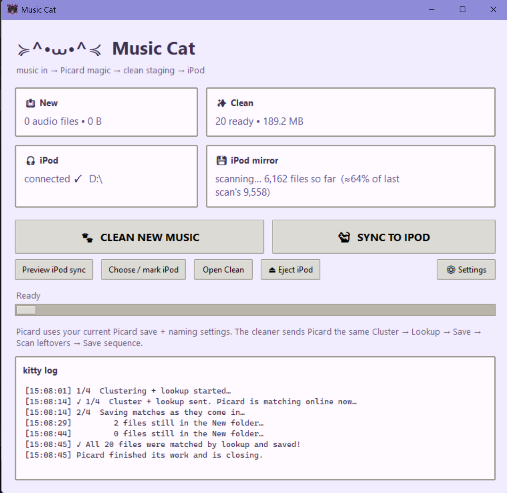
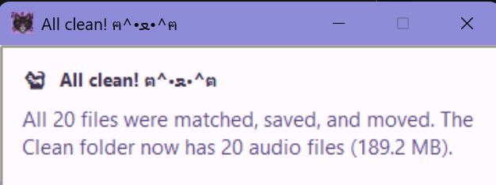
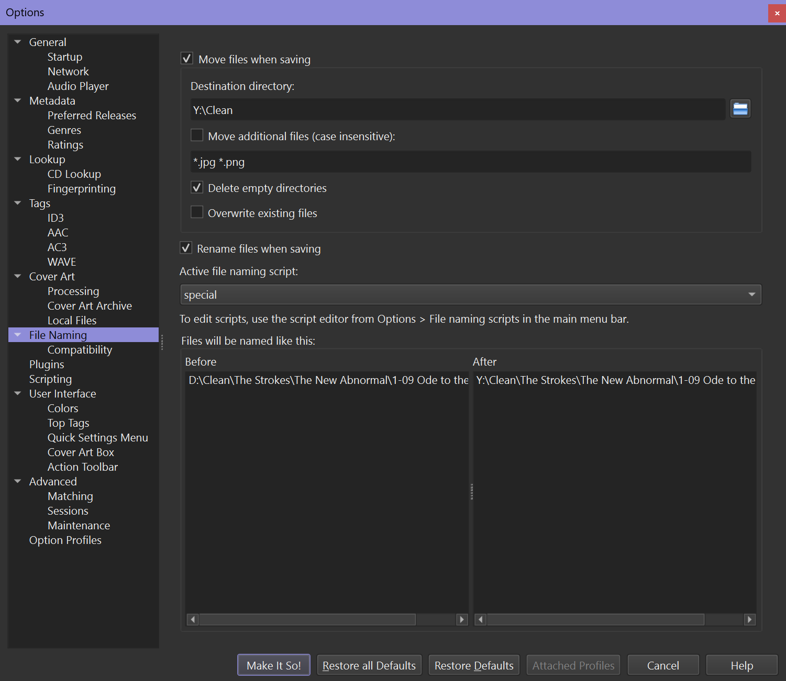
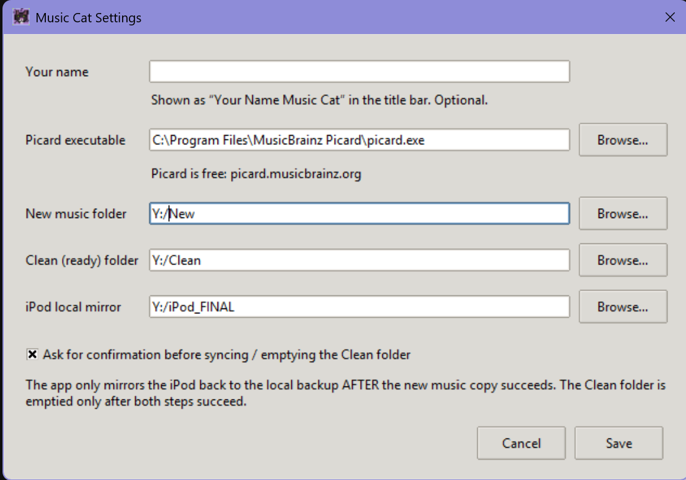

# Music Cat

A small Windows app that cleans up messy music files with
[MusicBrainz Picard](https://picard.musicbrainz.org) and syncs them to an iPod.
The window title becomes "*YourName* Music Cat" once you type your name in setup.



When everything finishes you get a little toast:



## What it does

1. Drop new music files into your **New** folder.
2. Press **Clean new music**. Music Cat sends the files through Picard
   (cluster, lookup, save matches, then scan only the leftovers) and the
   matches land in your **Clean** folder.
3. Plug in your iPod and press **Sync to iPod**. Music Cat:
   - copies the Clean folder onto the iPod,
   - updates your **iPod mirror** (a local backup copy of the iPod),
   - empties the Clean folder, but only if both copies worked.

There is also a **Preview iPod sync** button that does a pretend run and
shows what would change without copying or deleting anything.

## Requirements

- Windows 10 or 11 (it uses Windows' built in `robocopy`)
- [MusicBrainz Picard](https://picard.musicbrainz.org), installed
- An iPod that shows up as a normal drive letter in Windows (disk mode)

## Set up Picard first (important!)

Music Cat uses Picard's own save settings, so Picard has to be set up to move
cleaned files into Music Cat's **Clean** folder. In Picard go to
**Options > Options > File Naming** and:

- turn on **Move files when saving**
- set **Destination directory** to the **same folder as the Clean folder in
  Music Cat**

If the destination doesn't match, your files will end up somewhere else and
Music Cat will never see them. If "Move files when saving" is off, the files
just stay in the New folder.



Everything else on that page (renaming, your naming script, deleting empty
folders) is up to you. Music Cat uses whatever you have set. It also tries to
read Picard's settings and warns you before cleaning if they don't match.

## Getting started

**Option 1: the exe.** Download `Music Cat.exe` from the Releases page and
double click it.

**Option 2: run from source.** You need Python 3.9 or newer. There is nothing
to `pip install`.

```
python music_cat.py
```

### First launch

A welcome window explains how everything works and asks for:

- your name (optional, it just goes in the title bar)
- where Picard is installed (Music Cat tries to find it for you)
- your New, Clean and iPod mirror folders (missing folders get created)

The same window opens any time you press **Settings**.



The first time you sync, you will be asked to pick your iPod's drive once.
Music Cat puts a small marker file on it so it can find the iPod by itself
next time, whatever drive letter Windows gives it.

## How cleaning works

Picard's commands start the work but don't wait for it, so Music Cat watches
the New folder instead. It tells Picard to save whatever has matched every few
seconds, and when the New folder stops shrinking, the lookup is done. Only then
does it scan the files that are left (by audio fingerprint) so it doesn't
waste time scanning songs that lookup would have matched. Anything that still
doesn't match stays in Picard for you to fix by hand.

If Picard is slow on your connection, the waiting times are the
`LOOKUP_QUIET_SECONDS` and `SCAN_QUIET_SECONDS` settings near the top of
`music_cat.py`.

## About the iPod mirror

The mirror is a full copy of the iPod, kept on your computer or a network
drive. Syncing compares every file on the iPod with the mirror, so it can be
slow if the mirror is on a network drive, especially over a VPN or tunnel. The app shows
a live count and a timer while it works, and it checks many files at once
(`MIRROR_THREADS` near the top of `music_cat.py`).

The iPod marker file is not copied into the mirror.

## Where settings live

`%LOCALAPPDATA%\MusicCat\config.json`. Delete that folder to see the welcome
window again.

## Building the exe yourself

```
build_music_cat.bat
```

This installs PyInstaller and builds `dist\Music Cat.exe`.

## Things to know

- **Sync empties the Clean folder** after it has copied to the iPod and
  updated the mirror. It only does that when both steps succeed, but keep
  backups of music you care about.
- **The iPod mirror is a true mirror.** Files that are not on the iPod get
  removed from the mirror folder.
- **Network folders work but can be slow** to scan. The window opens right
  away and shows a live count while it scans.
- The exe is not code signed, so Windows SmartScreen or your antivirus may
  warn about it the first time. Running from source avoids that.

## Icon

Icon by me, but feel free to replace it! Put any square pixel art png in this
folder as `lilcat.png` and run `python make_icon.py` (needs
`python -m pip install pillow` once) to make a new `music_cat.ico`, then
rebuild.

## License

[MIT](LICENSE)
